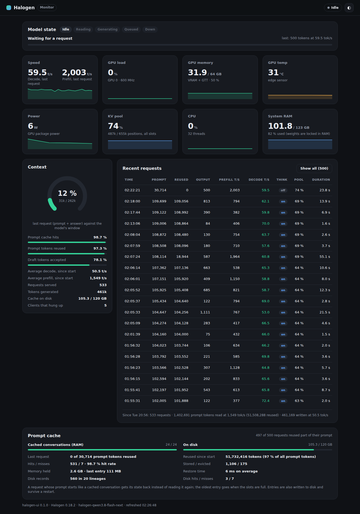

# halogen-ui

A live web monitor for a [Halogen](https://github.com/peonist-ai/halogen-flash-server) inference server: speed per
request, prefill progress, context and KV pool, prompt cache, GPU load / memory / temperature / power, and the list of
recent requests.

One small static binary written in Rust, **no dependencies**, read-only. Unofficial: not affiliated with the Halogen
authors.



## What it shows

| Panel | Source |
| --- | --- |
| Model state: idle, reading the prompt (with progress), generating, queued, down | `/metrics` + log progress lines |
| Speed of the last request: decode and prefill tokens/s, with history | log, one summary line per request |
| GPU load, memory (VRAM + GTT on unified-memory chips), temperature, power, clock | amdgpu sysfs, or `nvidia-smi` |
| KV pool fill, CPU load, system RAM | `/metrics`, `/proc` |
| Context of the last request against the model window | log + `/health` |
| Recent requests: prompt, reused, output, prefill t/s, decode t/s, thinking, pool, duration | log |
| Prompt cache: cached conversations, disk cache, reuse, hits / misses, evictions, restore time | `/cache` |
| Totals since Halogen started: requests, tokens read and reused, tokens written, average speeds | `/metrics` |

No prompt or answer text is ever read: Halogen's log only carries counts. The page can be shared publicly.

## Install

Build a static binary (Rust 1.85+, edition 2024):

```bash
rustup target add x86_64-unknown-linux-musl
cargo build --release --target x86_64-unknown-linux-musl
sudo install -m 755 target/x86_64-unknown-linux-musl/release/halogen-ui /usr/local/bin/halogen-ui
```

Run it on the machine that runs Halogen, so it can read the GPU sensors:

```bash
# Halogen as a systemd service (for example a Podman Quadlet):
halogen-ui --listen 0.0.0.0:8790 --log-cmd "journalctl -u halogen.service -f -n 3000 -o short-unix"

# Halogen in Docker or Podman (container named "halogen"):
halogen-ui --listen 0.0.0.0:8790 --log-cmd "docker logs -f -t --tail 3000 halogen"
```

Then open `http://<host>:8790`. A hardened systemd unit is in [`deploy/halogen-ui.service`](deploy/halogen-ui.service)
(dynamic user, member of `systemd-journal` only).

Behind a reverse proxy, any path prefix works (the page only uses relative URLs), for example with nginx:

```nginx
location = /halogen { return 301 /halogen/; }
location /halogen/ { proxy_pass http://127.0.0.1:8790/; limit_except GET { deny all; } }
```

## Options

| Flag | Variable | Default |
| --- | --- | --- |
| `--listen ADDR` | `HUI_LISTEN` | `127.0.0.1:8790` |
| `--halogen URL` | `HUI_HALOGEN` | `http://127.0.0.1:8731` |
| `--log-cmd CMD` | `HUI_LOG_CMD` | `docker logs -f -t --tail 3000 halogen` |
| `--title TEXT` | `HUI_TITLE` | `Halogen` |
| `--keep N` | `HUI_KEEP` | `500` finished requests kept in memory |
| | `HUI_HALOGEN_KEY` | API key, if Halogen requires one (never on the command line) |

The log command should print timestamps (`-o short-unix` for journalctl, `-t` for docker / podman); without them, the
backlog is stamped with the time it was read.

## API

- `GET /api/state`: everything the page shows, as JSON (`?all=1` for every kept request).
- `GET /healthz`: `ok`.

## Security

- Read-only: only `GET` and `HEAD` are answered.
- Strict Content-Security-Policy (no inline script, no third-party resource), `X-Frame-Options: DENY`,
  `Referrer-Policy: no-referrer`.
- The Halogen API key is read from the environment and never sent to the browser.
- Put it behind a reverse proxy with TLS before exposing it to the Internet.

## Development

```bash
cargo test
cargo clippy --all-targets
```

## License

MIT
